# KlimateIQ — Climate-Health Intelligence Platform

Winner of NigComSat Accelerator 3.0, Track C: Public Health Intelligence.

**Live**: [klimateiq.org](https://klimateiq.org) (product site) · [app.klimateiq.org](https://app.klimateiq.org) (the platform itself, deployed on AWS — EC2 + managed RDS Postgres)

**How this actually stands up right now**, not aspirationally:

- **774 real Nigerian LGAs** seeded with real coordinates and real 2020 UNFPA/US Census population figures — not placeholder data
- **21 live signal sources** feeding **16 named risk indices** across 6 sectors, with automatic fallback so no single data provider is a point of failure — see [`docs/MODEL.md`](docs/MODEL.md) for the exact formulas and [`docs/INGESTION_GUIDE.md`](docs/INGESTION_GUIDE.md) for the resilience pattern
- **A forecast lane, days ahead — and a likelihood, not just a score.** A 3-to-14-day discharge forecast (GloFAS) drives a dedicated Riverine Flood Forecast index, scored per named river reach for confluence LGAs; every major observed index also gets a forward score from the same forecast data. A 50-member weather/discharge ensemble turns that forecast into "≈62% chance of crossing high risk in the next 2 weeks" — see [`docs/MODEL.md`](docs/MODEL.md#forward-looking-forecast-scoring)
- **423 automated tests, all passing** — `php artisan test`
- Real transactional email (Resend), real error tracking (Sentry), real production monitoring (a Pipeline Health dashboard showing queue depth and per-source data freshness) — not just a demo path

## The problem

Nigeria carries the world's heaviest malaria burden by a wide margin. Per WHO's most recent
global malaria fact sheet: 610,000 people died of malaria worldwide in 2024, 579,000 of them
(95%) in the WHO African Region — and Nigeria alone accounts for 31.9% of the Region's deaths,
roughly 30% of the entire world's malaria deaths concentrated in one country. About three-quarters
of Regional malaria deaths are children under five.

Malaria isn't the only climate-linked health risk that follows a predictable pattern, either.
Anopheles mosquitoes breed in standing water, and outbreaks typically follow rainfall and flooding
by 2–4 weeks — the incubation window for mosquito populations to build and transmission to spread.
Heat stress, drought-driven food insecurity, and — during harmattan season — respiratory illness
from airborne dust all follow their own environmental lead indicators the same way. In every case,
the underlying environmental data already exists: satellites and reanalysis models measure
rainfall, standing water, temperature, vegetation stress, and air quality continuously. What
doesn't exist, for most health agencies, is the layer that turns "it rained 90mm this week" into
"intervene in this LGA now" — regionally specific, tied to a real threshold, and reaching the
person who can act on it before the lag window closes.

## The solution

KlimateIQ ingests environmental signals per Nigerian LGA, fuses them into named, purpose-built
risk indices — not one blended score — lets health agencies configure their own thresholds and
alerts per region, and gives every user a dashboard scoped to what they're actually responsible
for, not the whole country.

**Sector-first, not index-first.** A user picks the sectors matching their job — Public Health &
Epidemiology, Agriculture & Food Security, Emergency Response & Infrastructure, Water Sanitation &
Flooding, Environment & Air Quality, or the cross-cutting Overview — and their dashboard, region
pages, and onboarding scope to that automatically. An index can sit in more than one sector (Flood
Risk matters to both Water and Emergency Response); a new index attached to a followed sector shows
up with no action from the user.

**Three independently scalable layers:**

1. **Spatial Processing Layer** — scheduled/queued ingestion jobs pull environmental signals per
   region, normalized into a common `region_signals` table. A parallel, strictly separate
   `region_forecast_signals` table carries forward-looking (forecast and ensemble) data, so a
   forecast can never leak into a backtest or an anomaly baseline.
2. **Alerts & Notification Layer** — reacts only to `RegionScoreCalculated` /
   `RegionSignalIngested` / `RegionForecastScoreCalculated` *events*; it never calls into ingestion
   or scoring directly, so any layer can be deployed, scaled, or replaced independently of the
   others. A threshold can watch a fixed value, an anomaly against a region's own rolling baseline,
   or a forecast-probability crossing.
3. **User Interface Layer** — the sector-scoped dashboard, threshold configuration, and a
   documented third-party read API.

```mermaid
flowchart LR
    subgraph Sources["External data sources"]
        A["NASA POWER / Open-Meteo\n(rainfall, temperature, forecast, ensemble)"]
        B["JRC Global Surface Water\n(standing water)"]
        C["MODIS / Open-Meteo Archive\n(vegetation, soil, humidity, wind, UV)"]
        D["Open-Meteo Air Quality (CAMS)\n(PM2.5, PM10, ozone, NO2, SO2, CO, dust)"]
        E["Open-Meteo Flood API (GloFAS)\n(river discharge, forecast + ensemble)"]
        F["NASA FIRMS, SRTM, UNFPA/HDX\n(fire, elevation, population)"]
    end

    Sources --> G["SignalIngestionService\n(one class per source, one shared contract)"]
    G --> H[("region_signals")]
    G -.forecast/ensemble.-> H2[("region_forecast_signals")]
    H -- "RegionSignalIngested event" --> I["Threshold evaluation\n(per-signal alerts)"]
    H --> J["WeightedFormulaScoringStrategy"]
    H2 --> K["ForecastScoringStrategy /\nEnsembleForecastScoringService"]
    J --> L[("region_scores")]
    K --> L2[("region_forecast_scores")]
    L -- "RegionScoreCalculated event" --> M["Threshold evaluation\n(per-index alerts)"]
    L2 -- "RegionForecastScoreCalculated event" --> M
    M --> N["In-app / Email / SMS"]
    L --> O["Sector-scoped dashboard,\nCoverage, Third-party API"]
    L2 --> O
```



### Sixteen named indices, not one blended score

| Sector | Indices |
|---|---|
| **Overview** | Composite Climate-Health Pressure |
| **Public Health & Epidemiology** | Malaria Risk · Waterborne Disease Risk · Respiratory Risk · Heat Stress Risk · Meningitis Risk |
| **Agriculture & Food Security** | Drought Risk · Agriculture Stress · Irrigation Need · Rangeland Stress · Planting Window Risk |
| **Emergency Response & Infrastructure** | Flood Risk · Riverine Flood Forecast · Heat Stress Risk · Wildfire Risk · Dust Storm Risk |
| **Water, Sanitation & Flooding** | Flood Risk · Waterborne Disease Risk · Dry-Season Water Stress · Riverine Flood Forecast |
| **Environment & Air Quality** | Respiratory Risk · Dust Storm Risk |

Adding another index is a new row in `region_scoring_configs` — no code change. Every score
traces back to exactly which signal drove it (see the breakdown on any region's drill-down page,
or `region_scores.breakdown` directly), and every weight and calibration bound carries a
structured `calibration_status` (placeholder / admin-tuned / reference / reference-derived /
outcome-validated) so trust level is queryable data, not a claim in a doc. The exact formula,
every index's real weights, and every bound's source are written out in full in
[`docs/MODEL.md`](docs/MODEL.md).

### Forecast lane (T4) and probabilistic scoring (T5)

Everything above describes the *observed* lane — what already happened. A second, strictly
separate lane looks ahead:

- **Riverine Flood Forecast** — a dedicated forecast index built on GloFAS river-discharge
  forecasts, 3-to-14 days out. A confluence LGA (e.g. Lokoja, where the Niger and Benue meet) is
  scored **per named river reach**, not one blended centroid sample — the headline is the worst
  reach, and the page names which river is driving it.
- **Forward-scored observed indices** — Flood, Heat Stress, Malaria and Drought each also get a
  forecast-lane score from the same forward rainfall/temperature/discharge data, alongside their
  observed one.
- **Probabilistic scoring** — a 50-member weather/discharge ensemble (pooled across GFS, ECMWF and
  ICON for weather; GloFAS's own ensemble for discharge) turns the point forecast into a
  distribution: p10/p50/p90 and an exceedance probability — "≈62% chance of crossing high risk
  within 2 weeks" — with an alert rule that fires on that probability, not just a fixed value.
- **Calibration honesty carries through** — an LGA with no real per-reach discharge bound shows an
  explicit "not calibrated yet" state rather than a fabricated number; there is deliberately no
  system-wide fallback that could quietly peg every river at the same score.

See [`docs/decisions/`](docs/decisions/) for the dated design log behind these choices (forecast
and observed data in separate lanes, band cutoffs as a product choice, river-discharge return
periods, reach-level scoring, ensemble probability).

### AI, honestly scoped

- **Scoring** — `WeightedFormulaScoringStrategy` is what's live today: transparent, calibrated,
  explainable. `TrainedModelScoringStrategy` is a genuine architectural seam (same interface, same
  input/output shape) — see [`docs/MODEL.md`](docs/MODEL.md#two-scoring-strategies-by-design) for
  what activating it requires once historical case data is available.
- **Alerting** — thresholds can be a fixed value, an anomaly against a region's own rolling
  baseline (mean/stddev over its recent history), or a forecast-probability crossing — genuinely
  adaptive, not a fixed rule.
- **Reporting** — an OpenAI-powered summary turns a score's breakdown into a short plain-English
  explanation, restricted to only restating data already computed, cached alongside the score.

## What's under the hood

| Layer | Choice |
|---|---|
| Backend | Laravel 13 (PHP 8.3) |
| Frontend | Livewire 4 + Alpine.js, Tailwind 4 |
| Database | PostgreSQL 17 |
| Cache / sessions / queue | Redis |
| Queue worker | `systemd`-managed, auto-restarting |
| Scheduler | Laravel's own, driven by cron |
| Hosting | AWS EC2 (Amazon Linux 2023) + RDS Postgres, Nginx + PHP-FPM |
| Email | Resend |
| Error tracking | Sentry |
| Auth (third-party API) | Laravel Sanctum |

A single server-rendered stack (Laravel/Livewire) rather than a separate frontend/backend/ML
service split was a deliberate choice for a product whose core value is a configurable dashboard
and alerting engine, not a standalone inference service — it let the team ship a fully tested,
deployed, production-monitored platform in the time available, not a stack decision made for its
own sake.

### Where the code actually lives

```
app/Services/Ingestion/   one class per data source (observed, forecast, and ensemble variants)
app/Services/Scoring/     WeightedFormulaScoringStrategy, ForecastScoringStrategy,
                           EnsembleForecastScoringService, the trained-model seam, the resolver
app/Services/Alerts/      threshold evaluation — fixed value, rolling-baseline anomaly, or
                           forecast-probability crossing
app/Services/Ai/          OpenAI-backed score summaries
app/Notifications/        ThresholdBreachedNotification — in-app, email, SMS; forecast-aware
app/Console/Commands/     signals:ingest, signals:ingest-forecast, signals:ingest-ensemble,
                           scores:calculate, scores:forecast, calibrate:river-discharge, ...
docs/MODEL.md              the exact scoring formula, weights, calibration sources, and the
                           forecast/probability mechanics
docs/INGESTION_GUIDE.md   how to plug in a new signal source or index — no code change needed
docs/BUILD_PLAN.md        the code-level roadmap — what's shipped, what's next, and why
docs/decisions/           a dated ADR log of the judgment calls behind the scoring design
```

## Data sources

| Signal | Source | Status |
|---|---|---|
| Rainfall | NASA POWER, falls back to Open-Meteo (ERA5); forecast + ensemble via Open-Meteo | Live |
| Standing water | JRC Global Surface Water | Live |
| Temperature | NASA POWER, falls back to Open-Meteo (ERA5); forecast + ensemble via Open-Meteo | Live |
| Vegetation | MODIS (via NASA Earthdata/AppEEARS) | Live |
| Elevation | SRTM (Open Topo Data) | Live |
| Population exposure | UNFPA/US Census Bureau via HDX (2020 LGA-level projection) | Live, but not a per-request API pull — see [`docs/INGESTION_GUIDE.md`](docs/INGESTION_GUIDE.md#population-exposure) for what that means |
| Air quality (PM2.5, PM10, ozone, NO₂, SO₂, CO, dust) | Open-Meteo Air Quality API (CAMS) | Live |
| Soil moisture, soil temperature, evapotranspiration, humidity, wind, UV index | Open-Meteo Archive API (ERA5 / ERA5-Land) | Live |
| River discharge — observed, forecast, and 50-member ensemble | Open-Meteo Flood API (GloFAS) | Live |
| Active fire detections | NASA FIRMS (VIIRS NOAA-20) | Live — confirmation series, needs a free `FIRMS_MAP_KEY` |

No single provider is the platform's entire data backbone by design — see
[`docs/INGESTION_GUIDE.md`](docs/INGESTION_GUIDE.md#resilience-no-single-provider-is-a-single-point-of-failure)
for the resilience/fallback pattern and how a new source plugs in without touching scoring or
alerting.

All 774 real Nigerian LGAs are seeded (name, state, coordinates). Ingestion is usage-driven — a
region only gets pulled once someone actually watches it or requests it via Coverage, so the
platform doesn't waste cycles ingesting every LGA nobody's asked about.

## Alert channels, today

| Channel | Status |
|---|---|
| In-app | Live — the always-on baseline every user gets |
| Email | Live, via Resend, with a branded template |
| SMS | Built and tested end-to-end (including graceful no-op when unconfigured — see `tests/Feature/NotificationChannelsTest.php`), pending a production Termii account |

Each user chooses their own channels per alert type; a platform-wide switch can also disable
email outright without touching individual preferences. SMS being pending isn't a gap in the
code — `App\Notifications\Channels\SmsChannel` and `App\Services\Sms\TermiiSmsClient` are fully
implemented and covered by tests; it's waiting on a business account, not engineering.

## Setup

Requires PHP 8.3+, Postgres, Node 18+.

```bash
composer install
npm install
php artisan key:generate
```

Create a `.env` with `DB_CONNECTION=pgsql` and your database credentials. A handful of
integrations are optional and degrade gracefully without a key — email alerts (`RESEND_API_KEY`),
SMS alerts (`TERMII_API_KEY`), AI score summaries (`OPENAI_API_KEY`), Vegetation ingestion
(`NASA_EARTHDATA_USERNAME`/`NASA_EARTHDATA_PASSWORD`, free account at
[urs.earthdata.nasa.gov](https://urs.earthdata.nasa.gov/)), active-fire confirmation
(`FIRMS_MAP_KEY`, free key at [firms.modaps.eosdis.nasa.gov](https://firms.modaps.eosdis.nasa.gov/api/map_key/)),
and error tracking (`SENTRY_LARAVEL_DSN` — see `config/sentry.php`, a free Sentry project supplies
this). See `config/services.php` and `config/ingestion.php` for exactly which variables each one
reads. Then:

```bash
php artisan migrate
php artisan db:seed
npm run build
```

## Run

```bash
php artisan serve
php artisan queue:work    # processes ingestion jobs and alert-evaluation listeners
```

Prove the pipeline end-to-end:

```bash
php artisan signals:ingest --sync            # pulls real rainfall data for all seeded regions, synchronously
php artisan scores:calculate                 # computes every observed index for every region
php artisan signals:ingest-forecast          # pulls forward rainfall/temperature/discharge data
php artisan scores:forecast                  # computes the forecast lane (Riverine Flood Forecast + forward-scored observed indices)
```

Or on a schedule (already wired in `routes/console.php`):

```bash
php artisan schedule:work
```

## Tests

```bash
php artisan test
```

Uses a dedicated `gano_ai_test` Postgres database (see `phpunit.xml`) rather than SQLite — several
migrations use Postgres-specific constraints.

## Roadmap

The code-level roadmap — what's shipped, what's next, and the exact classes and config rows each
addition touches — is laid out in [`docs/BUILD_PLAN.md`](docs/BUILD_PLAN.md), with the
sector-level framing in [`docs/ROADMAP_SECTORS.md`](docs/ROADMAP_SECTORS.md).

Everything free-data-and-config-only on that roadmap is now shipped. What's left is genuinely
gated on things outside pure engineering:

- **Outcome validation** — a peer-reviewable backtest against real historical case/flood data.
  The single biggest remaining credibility gate, and it also unlocks `TrainedModelScoringStrategy`
  (the seam is already built — see [`docs/MODEL.md`](docs/MODEL.md#two-scoring-strategies-by-design)).
- **A licensed, multi-scenario climate outlook (CMIP6 to 2050)** — paused. The free source
  (Open-Meteo's Climate API) turned out to carry a single emissions pathway, not the multiple
  scenarios a real planning view needs.
- **Coastal resilience** (storm surge, Lagos/Niger Delta/Bayelsa) — needs high-resolution coastal
  elevation and tide-gauge data neither of which exist yet at usable resolution; not claimed as
  near-term.
- **A second country** — the data spine works anywhere by latitude/longitude, but each new country
  needs its own population data, administrative boundaries, and locally-calibrated thresholds
  before it goes live; gated on at least one Nigerian index being outcome-validated first.

Two things are engineering estimates today, not finished claims — stated plainly rather than
buried, because that's consistent with how the rest of the product works:

- **Agency membership is self-declared, not yet verified.** Anyone can select any existing agency
  (or type a new one) at signup. This gates "share with my agency" visibility on Saved Views and
  Reports today, and will matter more once cross-agency oversight exists. The planned fix —
  matching a user's email domain against a per-agency verified domain, with unverified claims held
  for admin review rather than silently trusted or blocked — is scoped, not built yet.

- **Scoring calibration bounds are mostly climatologically plausible defaults, not yet clinically
  validated.** A growing minority are better than that — Vegetation's `-1` to `1` range is a
  genuine scientific standard (NDVI's own definition), river-discharge bounds are now derived from
  ~40 years of GloFAS reanalysis return periods, and several air-quality bounds cite WHO/US-EPA
  reference points — but most weights and bounds are still reasonable, uncalibrated engineering
  estimates for Nigeria, not numbers checked against real health-outcome data yet. Every one of
  them carries a structured `calibration_status` so this is queryable, not just a claim in this
  doc — see `App\Support\CalibrationStatus` and the `CalibrationHonestyTest` that enforces it.

## Third-party API

Token-authenticated (Sanctum), read-only access to the same scores the dashboard renders — the
integration surface for another agency's own dashboard, without them rebuilding ingestion or
scoring.

Issue a token: **Admin → API Tokens** in the dashboard, or `POST /admin/api-tokens`.

| Endpoint | Returns |
|---|---|
| `GET /api/v1/indices` | Every named index (code, name, description) — all 16 |
| `GET /api/v1/regions` | Every seeded region (name, state, LGA code, coordinates, population) |
| `GET /api/v1/indices/{indexCode}/scores` | Latest score per region for one index; `?region_id=` to scope to one region |
| `GET /api/v1/regions/{region}/scores` | Full score history for one region; `?index=` to choose which index (defaults to Composite Climate-Health Pressure) |

```bash
curl https://app.klimateiq.org/api/v1/indices/MALARIA_RISK/scores \
  -H "Authorization: Bearer YOUR_TOKEN" \
  -H "Accept: application/json"
```
